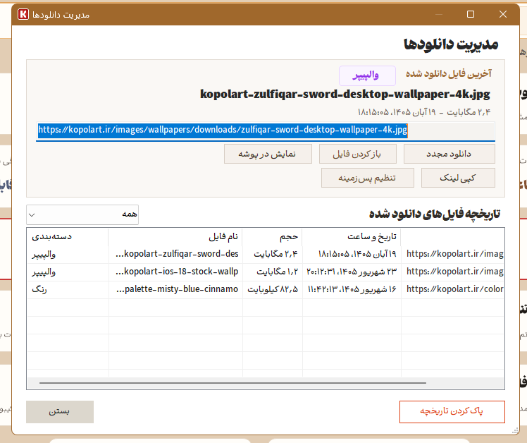

<div align="center">


# KopolArt for Windows

**The KopolArt experience on your desktop — a native browser shell, dashboard, download manager and wallpaper tools for [kopolart.ir](https://kopolart.ir).**


[**Download for Windows**](https://github.com/kopolart/kopolart-windows/releases/latest) ·
[Website](https://kopolart.ir) ·
[Report a bug](https://github.com/kopolart/kopolart-windows/issues)

</div>

---

## Screenshots

| Dashboard | Download manager |
| :---: | :---: |
|  |  |
| Quick access to colors, palettes, posts, wallpapers and tools, with live session stats | Recent download, copy link, re-download, set as wallpaper and full history |

| Dark theme |
| :---: |
|  |

<details>
<summary><b>More screenshots</b></summary>
<br />

| | |
| :---: | :---: |
|  |  |

</details>

## What is this?

A desktop client for [kopolart.ir](https://kopolart.ir) — a Persian platform for graphic design, programming and visual creativity. It wraps the site in a **native Windows shell**: a real title bar, browser controls, a dashboard, and desktop-only conveniences such as tray notifications, keyboard shortcuts and one-click wallpaper saving.

> This repository contains the **client only**. The website, backend, artwork, photography and written content are not part of this project and are not licensed here.

## Features

### Browsing
- Native window with back / forward / home / reload and the current URL
- **Find bar** for searching inside the page
- Dark and light themes that follow the app and the site
- Persian-first, right-to-left interface

### Dashboard
- Quick entry to colors, palettes, posts, wallpapers and tools
- Live session metrics: pages visited, time on site, traffic used and online users
- Personal profile and login entry point

### Library
- **Bookmarks** with an edit dialog
- **History** viewer with search and grouping
- **Download manager** with progress, history table, copy link, open file or folder, and re-download
- **Wallpaper tools**: preview, download and set as desktop wallpaper

### Desktop integration
- **Tray icon** with quick actions and minimise-to-tray
- **Notifications** for new posts, checked in the background
- **Automatic update checks** with an in-app prompt, download dialog and update history
- **Keyboard shortcuts** for navigation and common actions
- Create a **desktop shortcut** on request
- Tracks usage milestones and shows a summary

### Data
- **Backup and restore** of settings, bookmarks, history and downloads
- Import workflow with a choice of merge strategy
- Atomic settings storage so an interrupted write never corrupts your data

## Under the hood

```
Kopolart.Windows/                     Presentation — WinForms, WebView2, dialogs, controls
Kopolart.Windows.Application/         Use cases and application services
Kopolart.Windows.Domain/              Models and contracts
Kopolart.Windows.Infrastructure/      Settings, storage, platform adapters
```

- **.NET 11 + Windows Forms + WebView2**, `net11.0-windows10.0.17763.0`
- **Layered architecture** with dependency injection and thin forms
- Native and web talk through a small, explicit bridge instead of deep coupling
- Cached GDI font handles to avoid handle exhaustion during repaint loops
- Release builds ship trimmed, with embedded debug symbols for readable crash reports

## Install

1. Open the [latest release](https://github.com/kopolart/kopolart-windows/releases/latest).
2. Download `kopolart-win-x64.exe`.
3. Run it. Windows SmartScreen may ask for confirmation because the binary is not code-signed.

Requires **Windows 10 version 1809 (build 17763) or newer**, x64. WebView2 Runtime is used by the app; if it is not present on your system, install the Evergreen runtime from Microsoft.

## Build from source

Requirements: .NET 11 SDK, Visual Studio 2022+ or the `dotnet` CLI.

```bash
git clone https://github.com/kopolart/kopolart-windows.git
cd kopolart-windows

dotnet build Kopolart.Windows.sln -c Release
```

To produce a distributable executable:

```bash
dotnet publish Kopolart.Windows/Kopolart.Windows.csproj -c Release -r win-x64 --self-contained
```

### Fonts

The published source ships **Estedad** (SIL Open Font License 1.1). If the commercial **Abar** family is present in `assets/font` locally, it is embedded instead — the project and `FontManager` pick the family automatically, with no code changes. The Abar files are intentionally excluded from this repository because their license does not permit redistribution.

## Version

| | |
| --- | --- |
| Version | 1.6.2 |
| Executable | `kopolart-win-x64.exe` |
| Target | .NET 11, Windows 10 1809+ x64 |

Full release history and downloads live in [Releases](https://github.com/kopolart/kopolart-windows/releases).

## License

Source code: [MIT](LICENSE).

The MIT license covers **code only**. The KopolArt name, logo, wordmark, colour identity, artwork, photography, content and the `kopolart.ir` service are **not** licensed. See [NOTICE](NOTICE) before reusing anything beyond the source files.

## Acknowledgements

- [Estedad](https://github.com/aminabedi68/Estedad) — OFL 1.1
- Icon font generated with IcoMoon; Font Awesome Free glyphs are CC BY 4.0
- [Microsoft.Web.WebView2](https://learn.microsoft.com/microsoft-edge/webview2/) and the .NET team

---

<div dir="rtl">

## دربارهٔ نسخهٔ ویندوز

**کپل‌آرت برای ویندوز** نسخهٔ دسکتاپ سایت [kopolart.ir](https://kopolart.ir) است؛ با مرورگر اختصاصی، داشبورد، مدیریت دانلود، جستجو در صفحه، میان‌برهای کیبورد، آیکون سینی سیستم، اعلان مطالب جدید، به‌روزرسانی خودکار و پشتیبان‌گیری از داده‌ها.

- رابط فارسی و راست‌به‌چپ، با تم روشن و تاریک
- نصب: فایل `kopolart-win-x64.exe` را از بخش Releases دریافت و اجرا کنید (ویندوز ۱۰ نسخهٔ ۱۸۰۹ به بالا، ۶۴ بیتی)
- این مخزن فقط کد کلاینت ویندوز است؛ محتوا و سرویس سایت جزء آن نیستند.

</div>
