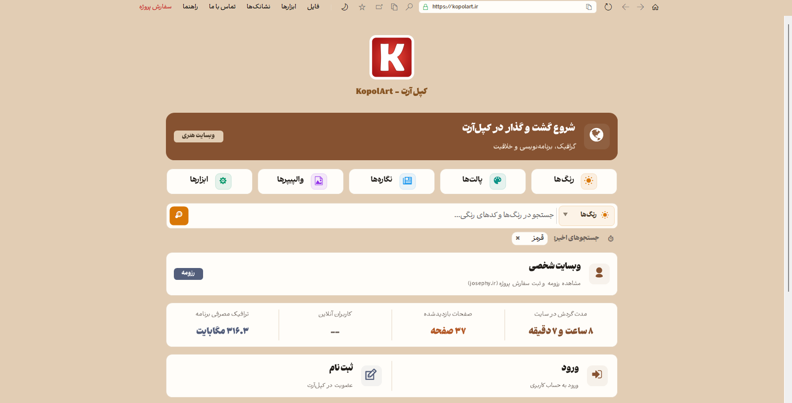
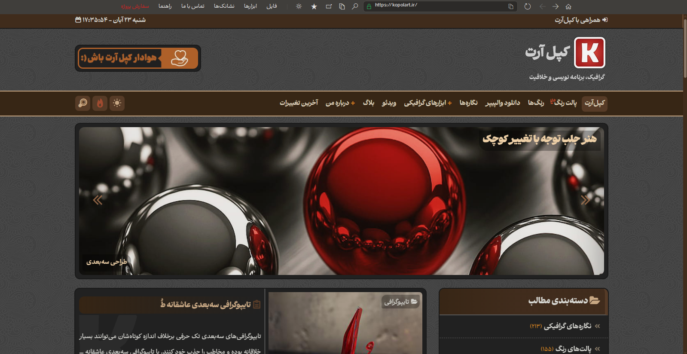
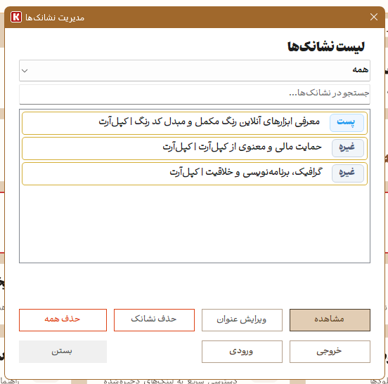
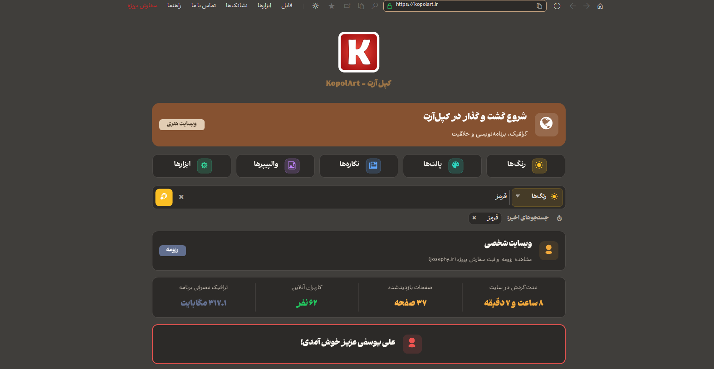

<div align="center">


# KopolArt for Windows

**The KopolArt experience on your desktop — a native browser shell, dashboard, download manager and wallpaper tools for [kopolart.ir](https://kopolart.ir).**


[**Download for Windows**](https://github.com/kopolart/kopolart-windows/releases/latest) ·
[Website](https://kopolart.ir) ·
[Report a bug](https://github.com/kopolart/kopolart-windows/issues)

</div>

---

## Screenshots

| Dashboard | Download manager |
| :---: | :---: |
|  |  |
| Quick access to colors, palettes, posts, wallpapers and tools, with live session stats | Recent download, copy link, re-download, set as wallpaper and full history |

| Dark theme |
| :---: |
|  |

<details>
<summary><b>More screenshots</b></summary>
<br />

| | |
| :---: | :---: |
|  |  |

</details>

## What is this?

A desktop client for [kopolart.ir](https://kopolart.ir) — a Persian platform for graphic design, programming and visual creativity. It wraps the site in a **native Windows shell**: a real title bar, browser controls, a dashboard, and desktop-only conveniences such as tray notifications, keyboard shortcuts and one-click wallpaper saving.

> This repository contains the **client only**. The website, backend, artwork, photography and written content are not part of this project and are not licensed here.

## Features

KopolArt for Windows is a real desktop client: native windows, native dialogs and desktop behaviour wrapped around the site.

| Area | Highlights |
| --- | --- |
| **Dashboard** | Native home, action cards, live metrics and a daily usage chart |
| **Browsing** | WebView2 engine, find bar, bookmarks, history, downloads |
| **Layouts** | Desktop, tablet and mobile layouts for the same content |
| **Wallpapers** | Multi-monitor preview, placement modes, apply to the desktop |
| **Desktop** | Tray icon, notifications, autostart, shortcuts, single instance |
| **Data** | Backup export/import, atomic settings, cache controls, activity logs |

### Dashboard

- **Native dashboard** with action cards for browsing, bookmarks, downloads, history, usage, shortcuts, settings, contact and about.
- **Live session metrics**: pages visited, time on site, traffic used and users online right now, plus a **daily usage chart**.
- **Search bar with suggestions** and recent queries that can be re-run with one click.
- **Profile card** showing account state with a direct sign-in entry point.
- **Personal website card** linking to the developer's portfolio.

### Browsing

- Chromium-based **WebView2** rendering with GPU acceleration and smooth scrolling.
- Full **navigation bar**: back, forward, home, reload and the current address.
- **Find bar** (`Ctrl+F`) with match counter and next / previous navigation.
- **Bookmarks** (`Ctrl+D`) with a themed edit dialog, **history** (`Ctrl+H`) with search and grouping, and **downloads** (`Ctrl+J`).
- **Normal and hard reload** (`Ctrl+R` / `F5`, `Ctrl+Shift+R`) plus `Alt+←` / `Alt+→` navigation.
- **External links open in your default browser** while the KopolArt session stays inside the app.
- **Light and dark themes** shared by the web content and every native dialog.

### Layouts — one client, three shapes

- Switch between **desktop, tablet and mobile layouts** from Settings, for comfortable reading on any screen or window size.

### Wallpapers

- **Preview dialog** with live image information and practical hints for low-resolution or portrait images.
- Choose the **target monitor** — a specific display or all monitors at once.
- Six **placement modes**: fill, fit, stretch, center, tile and span.
- Apply the wallpaper without touching Windows settings.

### Downloads

- **Progress dialog** with live percentage and transferred / total size for every file.
- **Download history** table with copy link, open file, open containing folder and re-download.
- One-click **set as wallpaper** from the download list or the tray menu.
- **Notifications** when a download finishes, with a shortcut to the file.

### Desktop integration

- **Single instance** — launching the app again focuses the running window instead of opening a second copy.
- **Tray icon** with quick actions and optional minimise-to-tray.
- **New-post notifications** checked in the background by a headless runner, so alerts arrive even when the window is closed.
- **Start with Windows** and optional **desktop shortcut** management.
- **Exit confirmation** so a stray click never closes your session.
- **Automatic update checks** with an in-app prompt, download dialog and update history.
- **Keyboard shortcut reference** built into the app.

### Data and privacy

- **Backup and restore** of settings, bookmarks, history and downloads to a portable file.
- **Import with a merge strategy** so restored data never silently overwrites newer work.
- **Atomic settings storage** — an interrupted write can never leave a corrupt configuration.
- **Cache and data controls**: clear cache, clear cookies, clear everything, and optionally clear cache on exit.
- **Activity log dialog** for diagnosing network and session behaviour.
- **Milestones** that summarise long-term usage on the usage page.

## Under the hood

```
Kopolart.Windows/                     Presentation — WinForms, WebView2, dialogs, controls
Kopolart.Windows.Application/         Use cases and application services
Kopolart.Windows.Domain/              Models and contracts
Kopolart.Windows.Infrastructure/      Settings, storage, platform adapters
```

- **.NET 11 + Windows Forms + WebView2**, `net11.0-windows10.0.17763.0`
- **Layered architecture** with dependency injection and thin forms
- Native and web talk through a small, explicit bridge instead of deep coupling
- Cached GDI font handles to avoid handle exhaustion during repaint loops
- Release builds ship trimmed, with embedded debug symbols for readable crash reports

## Install

1. Open the [latest release](https://github.com/kopolart/kopolart-windows/releases/latest).
2. Download `kopolart-win-x64.exe`.
3. Run it. Windows SmartScreen may ask for confirmation because the binary is not code-signed.

Requires **Windows 10 version 1809 (build 17763) or newer**, x64. WebView2 Runtime is used by the app; if it is not present on your system, install the Evergreen runtime from Microsoft.

## Build from source

Requirements: .NET 11 SDK, Visual Studio 2022+ or the `dotnet` CLI.

```bash
git clone https://github.com/kopolart/kopolart-windows.git
cd kopolart-windows

dotnet build Kopolart.Windows.sln -c Release
```

To produce a distributable executable:

```bash
dotnet publish Kopolart.Windows/Kopolart.Windows.csproj -c Release -r win-x64 --self-contained
```

### Fonts

The published source ships **Estedad** (SIL Open Font License 1.1). If the commercial **Abar** family is present in `assets/font` locally, it is embedded instead — the project and `FontManager` pick the family automatically, with no code changes. The Abar files are intentionally excluded from this repository because their license does not permit redistribution.

## Version

| | |
| --- | --- |
| Version | 1.6.2 |
| Executable | `kopolart-win-x64.exe` |
| Target | .NET 11, Windows 10 1809+ x64 |

Full release history and downloads live in [Releases](https://github.com/kopolart/kopolart-windows/releases).

## License

Source code: [MIT](LICENSE).

The MIT license covers **code only**. The KopolArt name, logo, wordmark, colour identity, artwork, photography, content and the `kopolart.ir` service are **not** licensed. See [NOTICE](NOTICE) before reusing anything beyond the source files.

## Acknowledgements

- [Estedad](https://github.com/aminabedi68/Estedad) — OFL 1.1
- Icon font generated with IcoMoon; Font Awesome Free glyphs are CC BY 4.0
- [Microsoft.Web.WebView2](https://learn.microsoft.com/microsoft-edge/webview2/) and the .NET team

---

<div dir="rtl">

## دربارهٔ نسخهٔ ویندوز

**کپل‌آرت برای ویندوز** نسخهٔ دسکتاپ سایت [kopolart.ir](https://kopolart.ir) است؛ با پنجره و دیالوگ‌های بومی ویندوز و امکاناتی که فقط در دسکتاپ معنا دارند:

- **داشبورد اختصاصی** با کارت‌های دسترسی سریع، آمار زندهٔ نشست و نمودار استفادهٔ روزانه
- **مرورگر WebView2** با نوار ناوبری کامل و جستجو در صفحه (`Ctrl+F`)
- **چیدمان دسکتاپ، تبلت و موبایل** برای همان محتوا، قابل تغییر از تنظیمات
- **مدیریت دانلود** با پنجرهٔ پیشرفت، تاریخچه، کپی لینک، باز کردن پوشه و دانلود مجدد
- **والپیپر دسکتاپ** با پیش‌نمایش، انتخاب مانیتور و شش حالت جای‌گذاری
- **آیکون سینی سیستم**، اجرای خودکار با ویندوز، اعلان مطالب جدید و تک‌نمونه‌ای بودن برنامه
- **به‌روزرسانی خودکار** با تاریخچهٔ به‌روزرسانی‌ها
- **پشتیبان‌گیری و بازیابی** تنظیمات، نشانک‌ها، تاریخچه و دانلودها
- رابط فارسی و راست‌به‌چپ با تم روشن و تاریک هماهنگ با محتوای سایت

نصب: فایل `kopolart-win-x64.exe` را از بخش Releases دریافت و اجرا کنید (ویندوز ۱۰ نسخهٔ ۱۸۰۹ به بالا، ۶۴ بیتی).

این مخزن فقط کد کلاینت ویندوز است؛ محتوا و سرویس سایت جزء آن نیستند.

</div>
